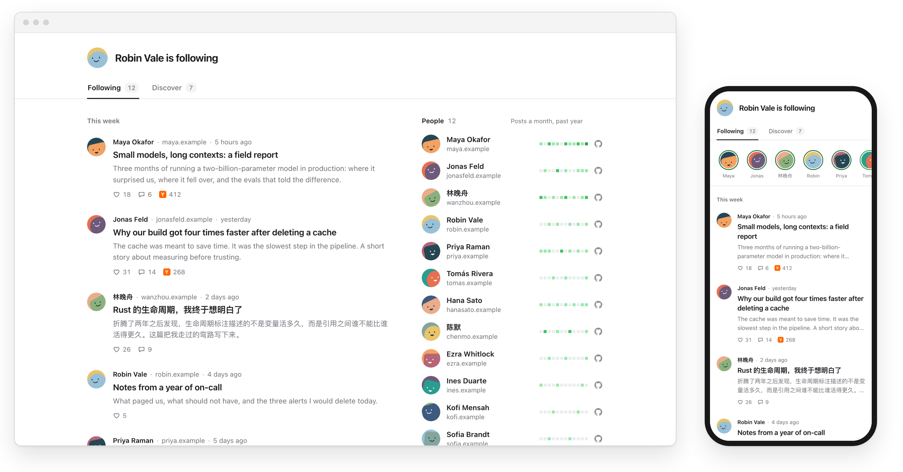

# followroll

See what the people you follow on GitHub are writing.

The screenshot shows made-up sample data.

It reads who you follow, finds their blogs on its own, and lists their latest
posts. A Discover tab shows blogs one step further out: people followed by the
people you follow. Nobody has to sign up, and there is no server: it runs on
GitHub Actions and GitHub Pages.

## Get your own

1. **Fork** this repository.
2. Open the **Actions** tab of your fork and enable workflows.
3. Open **Settings → Pages** and set **Source** to **GitHub Actions**.
4. In **Actions**, run the **Following** workflow.

Your page appears at `https://<you>.github.io/followroll/` and refreshes every
six hours. For later improvements, press **Sync fork**.
